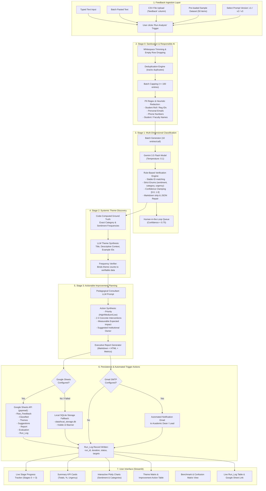

# System Workflow Diagram

This document illustrates the end-to-end architecture and autonomous trigger-action execution pipeline of the **Student Feedback Analysis System**.

## Stage Descriptions

1. **Stage 0 (Ingestion & Anonymization)**:
   Raw student inputs are trimmed, empty rows dropped, and duplicates filtered. A deterministic regex and heuristic pipeline redacts emails, phone numbers, student roll IDs, and personal names. Raw personal data is never transmitted to the LLM.

2. **Stage 1 (Classification)**:
   Preprocessed feedback is batched in groups of 10 to optimize token throughput and latency. One of three prompt versions (`v1 Baseline`, `v2 Structured`, `v3 Few-Shot + Strict JSON`) classifies each entry into sentiment, category, urgency, and confidence. Rule-based checks verify enum values and JSON formatting. Entries with confidence $< 0.75$ are placed into a Human-in-the-Loop review queue.

3. **Stage 2 (Theme Discovery)**:
   Frequency counts are computed directly in Python code from classified entries. The LLM receives verifiable counts and identifies 3 to 6 overarching institutional themes, attaching representative feedback IDs. Theme frequencies are mathematically bounded by code.

4. **Stage 3 (Improvement Planning & Report)**:
   For each identified theme, the system generates 2 to 3 concrete interventions, priority ratings, expected impacts, and assigns responsible institutional owners. An executive report is compiled in Markdown and HTML.

5. **Automation & Persistence**:
   Trigger-action execution persists raw inputs, classified entries, recurring themes, suggestions, report summaries, and evaluation runs into Google Sheets (or the local SQLite fallback). If Gmail SMTP is configured, an executive summary email is dispatched automatically. Every execution appends a verifiable entry to `Run_Log`.

